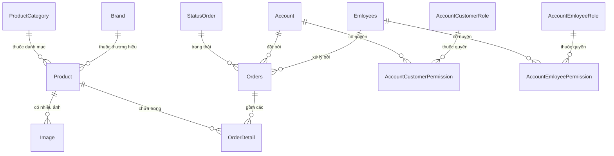

# ShopLapTop - Hệ Thống Website Bán Hàng & Quản Lý Cửa Hàng Laptop

> **Đồ án môn học:** Lập trình Web ASP.NET  
> **Repository:** [MAICHIVINH/QuanLyCuaHangLapTop](https://github.com/MAICHIVINH/QuanLyCuaHangLapTop.git)  

---

## Giới thiệu dự án

**ShopLapTop** là ứng dụng web thương mại điện tử chuyên cung cấp và kinh doanh các sản phẩm máy tính xách tay (laptop), linh kiện và phụ kiện công nghệ. Hệ thống được xây dựng trên nền tảng **ASP.NET Web Forms (.NET Framework 4.8)** kết hợp với cơ sở dữ liệu **Microsoft SQL Server**, sử dụng mô hình ánh xạ dữ liệu **LINQ to SQL**.

Hệ thống đáp ứng trọn vẹn hai đối tượng người dùng:
1. **Khách hàng (Client):** Trải nghiệm mua sắm mượt mà, phân loại laptop theo nhu cầu sử dụng/thương hiệu, tìm kiếm, giỏ hàng, đặt hàng trực tuyến, theo dõi hành trình đơn hàng và đánh giá sản phẩm.
2. **Nhà quản trị & Nhân viên (Admin/Staff):** Trang quản trị riêng biệt cho phép thống kê doanh thu, báo cáo Top sản phẩm / khách hàng / thương hiệu theo Ngày/Tháng/Năm, xuất báo cáo ra Excel, phân quyền nhân viên và quản lý toàn diện danh mục, sản phẩm, đơn hàng.

---

## Công nghệ sử dụng

| Thành phần | Công nghệ / Thư viện | Ghi chú |
| :--- | :--- | :--- |
| **Backend** | C#, ASP.NET Web Forms | Target Framework: .NET 4.8 |
| **Database** | Microsoft SQL Server | Script: `Advice.sql` |
| **ORM / Data Access**| LINQ to SQL (`.dbml`) | `ShopDataContext` |
| **Frontend** | HTML5, CSS3, JavaScript | Custom CSS & Responsive layout |
| **Icons & Font** | Font Awesome 6.0 | Biểu tượng người dùng, giỏ hàng, đơn hàng |
| **Báo cáo & Thống kê** | EPPlus (v7.5.0) | Đọc / Ghi và xuất file Excel (.xlsx) |
| **Bảo mật** | SHA-256 Hashing + Salt | Mã hóa mật khẩu người dùng & nhân viên |
| **IDE Khuyến nghị** | Microsoft Visual Studio (2019 / 2022) | Hỗ trợ IIS Express |

---

## Tính năng nổi bật

### 1. Phân hệ Khách hàng (Client)
* **Trang chủ & Danh mục đa dạng:**
  * Phân loại laptop theo nhu cầu thực tế: *Mỏng nhẹ, Văn phòng, Gaming, MacBook, Cao cấp*.
  * Lọc theo thương hiệu nổi tiếng: *Apple, Dell, Asus, Acer, HP, Lenovo, MSI*.
* **Tìm kiếm & Xem chi tiết:**
  * Tìm kiếm nhanh theo tên sản phẩm hoặc từ khóa.
  * Trang chi tiết sản phẩm hiển thị đầy đủ thông số kỹ thuật (CPU, RAM, Màn hình, Pin), thư viện ảnh thực tế đa góc nhìn và phần trăm giảm giá.
* **Giỏ hàng & Đặt hàng:**
  * Thêm/xóa sản phẩm, cập nhật số lượng trực tiếp trong giỏ hàng.
  * Tự động tính toán tổng tiền và áp dụng ưu đãi.
  * Đặt hàng kèm lưu thông tin giao nhận, số điện thoại, ghi chú.
* **Theo dõi đơn hàng & Đánh giá:**
  * Theo dõi tiến độ đơn hàng qua 5 trạng thái trực quan:
    1. *Chờ xác nhận*
    2. *Đã xác nhận*
    3. *Đang chuẩn bị hàng*
    4. *Hàng đang được giao*
    5. *Hàng đã giao đến bạn*
  * Xem lịch sử mua hàng cá nhân.
  * Đánh giá chất lượng và số sao cho sản phẩm sau khi mua.
* **Hệ thống Tài khoản:**
  * Đăng ký tài khoản mới, Đăng nhập hệ thống.
  * Quên mật khẩu & cấp lại mật khẩu.
  * Cập nhật thông tin cá nhân (Địa chỉ, Giới tính, Tỉnh/Thành phố).

---

### 2. Phân hệ Quản trị (Admin & Nhân viên)
* **Dashboard Thống kê & Báo cáo:**
  * Thống kê tổng doanh thu thực tế.
  * Báo cáo **Top khách hàng mua nhiều nhất** theo Ngày / Tháng / Năm.
  * Báo cáo **Top thương hiệu** và **Top sản phẩm bán chạy nhất**.
  * **Xuất dữ liệu Excel (.xlsx)** trực tiếp thông qua thư viện EPPlus phục vụ báo cáo kế toán/kinh doanh.
* **Quản lý danh mục & Thương hiệu (Brand & Category):**
  * Thêm mới, chỉnh sửa, khóa/mở trạng thái hiển thị của các hãng và phân khúc sản phẩm.
* **Quản lý sản phẩm (Product):**
  * Quản lý thông tin máy, giá bán, số lượng tồn kho, giảm giá, thông số kỹ thuật.
  * Tải lên và quản lý thư viện hình ảnh chi tiết của sản phẩm.
* **Quản lý đơn hàng (Orders & OrderDetail):**
  * Tiếp nhận đơn hàng mới, duyệt và phân công xử lý.
  * Chuyển trạng thái đơn hàng xuyên suốt quy trình vận chuyển.
* **Quản lý tài khoản & Phân quyền:**
  * Quản lý thông tin khách hàng.
  * Quản lý danh sách nhân viên và cấp phát quyền hạn chi tiết (Thêm/Sửa/Xóa sản phẩm, thương hiệu, loại sản phẩm, đơn hàng, tài khoản).
* **Quản lý liên hệ & phản hồi:**
  * Xem và xử lý các ý kiến, khiếu nại hoặc tin nhắn từ khách hàng gửi về.

---

## Cấu trúc thư mục dự án

```text
ShopLapTop/
├── Advice.sql                      # Script tạo cơ sở dữ liệu và dữ liệu mẫu
├── ShopLapTop.sln                  # File Solution Visual Studio
├── packages/                       # Thư viện NuGet ngoại vi
└── ShopLapTop/                     # Thư mục mã nguồn web
    ├── App_Data/                   # Dữ liệu nội bộ ứng dụng
    ├── Admin/                      # Phân hệ quản trị
    │   ├── Login.aspx              # Đăng nhập dành cho Admin/Nhân viên
    │   ├── Manager.Master          # Master Page của Admin
    │   ├── Manager2.aspx           # Trang Dashboard thống kê, biểu đồ & xuất Excel
    │   ├── ManagerBill/            # Quản lý hóa đơn / đơn đặt hàng
    │   ├── ManagerBillDetail/      # Chi tiết hóa đơn
    │   ├── ManagerBrand/           # Quản lý hãng / thương hiệu
    │   ├── ManagerCategories/      # Quản lý loại sản phẩm
    │   ├── ManagerContact/         # Quản lý liên hệ
    │   ├── ManagerCustomer/        # Quản lý khách hàng
    │   ├── ManagerEmloyee/         # Quản lý nhân viên & phân quyền
    │   └── ManagerProduct/         # Quản lý sản phẩm & hình ảnh
    ├── Login/                      # Xác thực khách hàng
    │   ├── Logins.aspx             # Đăng nhập khách hàng
    │   ├── Register.aspx           # Đăng ký tài khoản
    │   └── ForgotPassword.aspx     # Lấy lại mật khẩu
    ├── Views/                      # Các trang nghiệp vụ khách hàng
    │   ├── Orders/                 # Giỏ hàng, Đơn hàng, Lịch sử & Đánh giá
    │   │   ├── Carts.aspx
    │   │   ├── OrderStatus.aspx
    │   │   ├── OrderHistory.aspx
    │   │   └── EvaluateProduct.aspx
    │   └── Pages/                  # Xem & Tìm kiếm sản phẩm
    │       ├── DetailProduct.aspx  # Chi tiết sản phẩm
    │       ├── ProductCategory.aspx# Sản phẩm theo danh mục
    │       ├── ProductGroup.aspx   # Sản phẩm theo nhóm
    │       ├── Search.aspx         # Tìm kiếm sản phẩm
    │       └── UpdateUser.aspx     # Cập nhật thông tin cá nhân
    ├── Style/                      # CSS stylesheet và hình ảnh sản phẩm
    ├── Index.Master                # Master Page trang bán hàng (Client)
    ├── SubPage.aspx                # Trang chủ chính của website
    ├── Shop.dbml                   # Mô hình LINQ to SQL ánh xạ CSDL
    ├── Global.asax                 # File cấu hình vòng đời ứng dụng
    ├── packages.config             # Danh sách gói NuGet phụ thuộc
    └── Web.config                  # Cấu hình connection string & runtime
```

---

## Thiết kế Cơ sở dữ liệu

Database gồm các bảng chính sau:



* **ProductCategory** (`CategoryID`, `CategoryName`, `Status`): Phân loại máy (Gaming, Văn phòng, Mỏng nhẹ,...).
* **Brand** (`BrandID`, `BrandName`, `Status`): Hãng sản xuất (Apple, Asus, Dell, Acer, Lenovo,...).
* **Product** (`ProductID`, `ProductName`, `Price`, `Image`, `Details`, `Description`, `StockQuantity`, `CategoryID`, `BrandID`, `Discount`,...): Thông tin sản phẩm.
* **Image** (`ImageID`, `ImageName`, `ProductID`): Hình ảnh bổ sung cho sản phẩm.
* **Account** (`AccountID`, `FullName`, `Email`, `Password`, `Address`, `Gender`, `PASSWORD_HASH`, `PASSWORD_SALT`,...): Tài khoản khách hàng.
* **Orders** (`OrderID`, `FullName`, `Address`, `OrderTime`, `TotalAmount`, `Status`, `PhoneNumber`, `AccountID`, `emloyee_id`): Thông tin đơn hàng.
* **OrderDetail** (`OrderDetailID`, `Quantity`, `UnitPrice`, `OrderID`, `ProductID`): Chi tiết từng sản phẩm trong đơn.
* **StatusOrder** (`status_id`, `status_name`): Danh mục 5 bước trạng thái xử lý đơn.
* **Emloyees** (`emloyee_id`, `emloyee_fullname`, `emloyee_email`, `emloyee_phone`, `PASSWORD_HASH`, `PASSWORD_SALT`,...): Tài khoản nhân viên.
* **AdminAdvice** (`ID_ADMIN`, `FULLNAME`, `USERNAME`, `PASSWORD`,...): Quản trị viên cấp cao.

---

## Hướng dẫn Cài đặt & Chạy dự án

### 1. Yêu cầu hệ thống
* **Hệ điều hành:** Windows 10/11
* **IDE:** Microsoft Visual Studio 2019 hoặc Visual Studio 2022 (cài đặt workload **ASP.NET and web development**)
* **Cơ sở dữ liệu:** Microsoft SQL Server 2016 trở lên & SQL Server Management Studio (SSMS)
* **.NET Framework:** Phiên bản 4.8

### 2. Cài đặt Cơ sở dữ liệu
1. Mở **SQL Server Management Studio (SSMS)** và kết nối vào SQL Server cục bộ của bạn.
2. Mở file [Advice.sql](Advice.sql).
3. Nhấn **Execute (F5)** để tạo Database `Advice` cùng các bảng và nạp sẵn dữ liệu ban đầu (Sản phẩm, Hãng, Danh mục, Tài khoản demo).

### 3. Cấu hình Chuỗi kết nối (Connection String)
Mở tệp `ShopLapTop/Web.config` và điều chỉnh thông số `Data Source` phù hợp với tên SQL Server trên máy tính của bạn:

```xml
<connectionStrings>
  <!-- Thay MAICHIVINH bằng tên SQL Server máy của bạn (ví dụ: localhost hoặc .\SQLEXPRESS) -->
  <add name="Shop2ConnectionString" 
       connectionString="Data Source=localhost;Initial Catalog=Advice;Integrated Security=True" 
       providerName="System.Data.SqlClient"/>
  <add name="AdviceConnectionString" 
       connectionString="Data Source=localhost;Initial Catalog=Advice;Integrated Security=True" 
       providerName="System.Data.SqlClient"/>
</connectionStrings>
```

> **Lưu ý:** Nếu bạn dùng tài khoản SQL Server Authentication (`sa`), có thể đổi chuỗi kết nối thành:  
> `Data Source=localhost;Initial Catalog=Advice;User ID=sa;Password=your_password;`

### 4. Khởi chạy ứng dụng
1. Mở file `ShopLapTop.sln` bằng Visual Studio.
2. Chuột phải vào Solution -> Chọn **Restore NuGet Packages** để tự động tải các package (như EPPlus).
3. Chuột phải vào trang `SubPage.aspx` -> Chọn **Set As Start Page** (hoặc chọn `Admin/Login.aspx` nếu muốn bắt đầu từ trang Admin).
4. Nhấn **F5** (hoặc chọn **IIS Express (Google Chrome/Edge)**) để biên dịch và chạy website trên trình duyệt.

---

## Tài khoản mặc định tham khảo

* **Khách hàng demo:**
  * Email: `vinh123@gmail.com` | Mật khẩu: `123`
* **Trang quản trị:** Truy cập URL `/Admin/Login.aspx` để đăng nhập vào trang quản trị.

---

## Bản quyền & Đóng góp
Dự án được xây dựng phục vụ học tập và nghiên cứu môn học Lập trình Web ASP.NET. Mọi quyền đóng góp và chia sẻ vui lòng gửi qua Github repository: [MAICHIVINH/QuanLyCuaHangLapTop](https://github.com/MAICHIVINH/QuanLyCuaHangLapTop.git).
